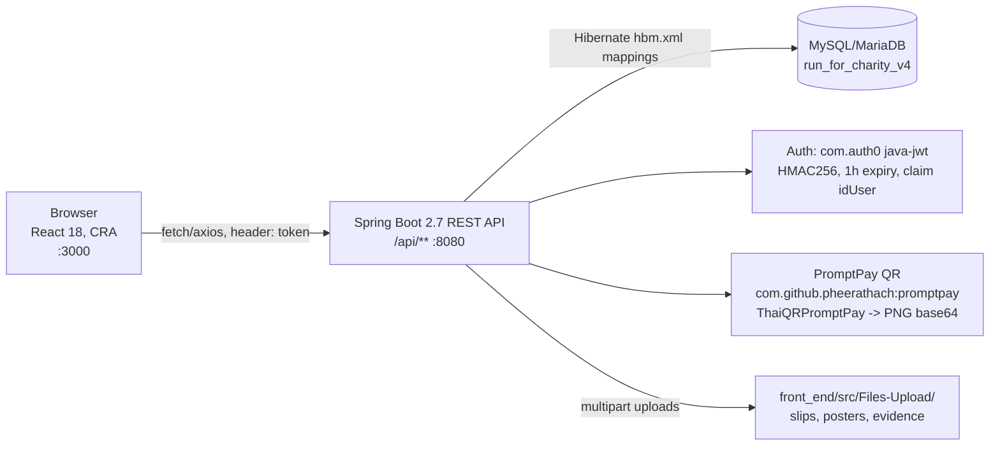
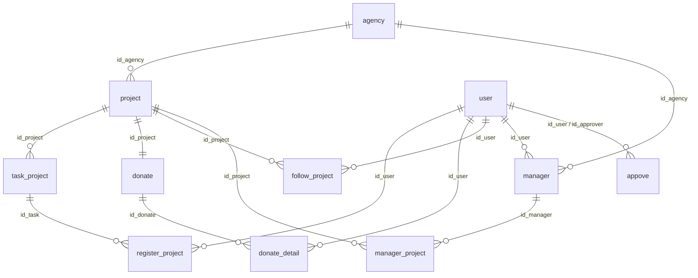

# Run for Charity

A web platform where charities (agencies) publish charity run events, runners sign up for a distance and pay the entry fee by scanning a Thai PromptPay QR code, and agency staff and admins approve agencies, events, runners and payments.

Stack: React 18 (Create React App) front end, Spring Boot 2.7 / Java 11 REST API with Hibernate, MySQL/MariaDB, PromptPay QR generation on the server.

## What it does

| Feature | Who uses it | Where in code |
|---|---|---|
| Register, log in, get a JWT and a role | everyone | `back_end/.../restservice/RegisterController.java`, `LoginController.java`, `front_end/src/pages/authen/` |
| Browse approved run events and event details, follow/unfollow | runners (`user`) | `ProjectController.java`, `FollowProjectController.java`, `front_end/src/pages/EventPage.jsx`, `Detaileventpage.jsx` |
| Pick a distance (task), get a PromptPay QR for the fee, upload the payment slip | runners | `QRCodeController.java`, `RegisterProjectController.java`, `front_end/src/pages/DonatePage.jsx`, `RegisterForRun.jsx` |
| Donation and participation history | runners | `DonateDetailController.java`, `front_end/src/pages/user/historyDonate.jsx`, `historyJoin.jsx` |
| Request a new agency, apply to join one | runners | `AgencyController.java`, `front_end/src/pages/user/createAgency.jsx`, `RegisterAgency.jsx` |
| Create an event with poster, profile image, evidence file and distances/prices | project managers (`ผู้รับผิดชอบโครงการ`) | `ProjectController.java`, `TaskProjectController.java`, `front_end/src/pages/responsibleProject/` |
| Approve events and managers, approve runner payments | agency managers (`ผู้รับผิดชอบหน่วยงาน`) | `ProjectController.java` (`PUT /projects/{id}/{status}`), `ManagerProjectController.java`, `front_end/src/pages/agency/`, `ApproveRunner.jsx` |
| Approve agencies, view all projects/agencies/payments | `admin` | `AgencyController.java` (`PUT /auth/agencies/{id}/{status}`), `AppoveController.java`, `front_end/src/pages/admin/` |

## Architecture



A payment starts on the event detail page (`Detaileventpage.jsx`), which sends the browser to `/donate/:taskId`. `DonatePage.jsx` loads the distance via `GET /api/taskprojects/id/{id}`, then calls `POST /api/auth/createqrcode/{phone}/{amount}` with the organiser's phone number from the project and the task price. The server builds a dynamic credit-transfer PromptPay payload with `ThaiQRPromptPay.Builder` and returns `drawToBase64(300, 300)` as a `data:image/png;base64,...` string, which the page renders. The runner pays in their banking app, uploads the slip, and the page posts it as multipart `evidencefile` to `POST /api/auth/registerprojects/{taskId}`; the API stores the file under `front_end/src/Files-Upload/` with a UUID name and inserts a `register_project` row with status `รอพิจารณา` (pending), unless the task's `limit_join` is reached. A manager later approves it with `PUT /api/auth/registerprojects/status/{id}` (`ApproveRunner.jsx`). Nothing is verified against the bank; approval is manual from the slip.

Every `/api/auth/**` endpoint reads the JWT from a `token` request header and resolves the user (`UserService.validateToken`); role checks are done ad hoc inside a few controllers. CORS is fixed to `http://localhost:3000`.

## Repository layout

```
run_for_charity/
├── back_end/run_for_charity/        Spring Boot API (Maven, mvnw included)
│   ├── pom.xml                      Spring Boot 2.7.9, Java 11, mysql-connector 5.1.49, java-jwt, promptpay
│   ├── src/main/java/*.hbm.xml      Hibernate mappings (catalog hard-coded to run_for_charity_v4)
│   ├── src/main/java/th/ac/ku/kps/eng/cpe/se/
│   │   ├── restservice/             controllers (all under /api)
│   │   ├── service/ repository/     business logic, Spring Data JPA repositories
│   │   ├── model/ dto/ response/    entities, request and response types
│   │   └── util/FileUploadUtil.java writes uploads to ../../front_end/src/Files-Upload
│   ├── src/main/resources/application.properties   port, datasource, mapping list
│   ├── .metadata/ bin/              Eclipse workspace and build output (committed by mistake)
├── front_end/                       Create React App
│   ├── src/App.js                   react-router v6 routes
│   ├── src/pages/                   user/, responsibleProject/, agency/, admin/, authen/
│   ├── src/component/               navbar and role-specific sidebars
│   └── src/Files-Upload/            uploaded slips and images (served by CRA dev server)
├── database/run_for_charity_v4.sql  phpMyAdmin dump (MariaDB 10.4): schema + sample data
└── Prototype/                       static HTML/CSS/JS mockups that preceded the React app
```

## Run locally

Prerequisites: Java 11, a MySQL 5.7/MariaDB 10.x server on `localhost:3306`, Node.js with npm (version not pinned; `react-scripts` 5). Maven is provided by the wrapper (`mvnw`, Maven 3.8.6).

Before starting the API, set `spring.datasource.username` and `spring.datasource.password` in `back_end/run_for_charity/src/main/resources/application.properties` to your own MySQL credentials. The dump does not create the database, and the Hibernate mappings require the name `run_for_charity_v4`.

```bash
mysql -u root -p -e "CREATE DATABASE run_for_charity_v4 CHARACTER SET utf8 COLLATE utf8_unicode_ci"
mysql -u root -p run_for_charity_v4 < database/run_for_charity_v4.sql
cd back_end/run_for_charity && ./mvnw spring-boot:run        # API on http://localhost:8080
cd front_end && npm install
npm start                                                     # UI on http://localhost:3000
```

Run the API from `back_end/run_for_charity` so the relative upload path resolves. API URLs are hard-coded to `http://localhost:8080` in the pages. Sample logins are in the `user` rows of the SQL dump.

## API

All paths are prefixed with `/api`. Paths under `/auth/` require a `token` header holding the JWT returned by `/login`. Responses are JSON with `status` and `msg` fields rather than HTTP status codes.

| Method | Path | Purpose |
|---|---|---|
| POST | `/user/create` | Register a new account (role `user`) |
| POST | `/login` | Check credentials, return `accessToken` and `role` |
| GET | `/projects`, `/projects/{id}`, `/projects/status/{status}` | List events, event detail, filter by status |
| POST | `/projects/{agencyId}` | Create an event (multipart: `project`, `appove`, `evidencefile`, `imagePofilefile`, `imagePosterfile`); status `รอพิจารณา` |
| PUT | `/projects/{id}/{pass\|fail}` | Agency manager approves/rejects an event; approval opens its `donate` pot |
| GET / POST | `/taskprojects/{projectId}`, `/auth/taskprojects/{projectId}` | List / add distances with price and runner limit |
| POST | `/auth/createqrcode/{phone}/{amount}` | PromptPay QR as base64 PNG |
| POST | `/auth/registerprojects/{taskId}` | Sign up for a distance, multipart `evidencefile` (payment slip) |
| PUT | `/auth/registerprojects/status/{id}` | Approve/reject a runner's registration |
| POST / DELETE | `/auth/followprojects/{projectId}` | Follow / unfollow an event |
| POST | `/auth/agencies` | Request a new agency (creates `appove` of type `อนุมัติหน่วยงาน`) |
| PUT | `/auth/agencies/{appoveId}/{pass\|fail}` | Admin approves an agency and promotes the requester to agency manager |
| GET | `/auth/appoves`, `/auth/appoves/type/{type}` | Approval queue, optionally by type |
| GET | `/auth/donatedetails`, `/auth/donatedetailbyadmin` | Donation history for the caller / for all users |
| POST | `/auth/donatedetails/{projectId}` | Record a donation against a project's pot |

## Data model

14 tables, Thai enum values for statuses (`อนุมัติ` approved, `ไม่อนุมัติ` rejected, `รอพิจารณา` pending).

- `user` — account keyed by `id_user` (string), name, age, address, phone, email, `role` (`user`, `admin`, `ผู้รับผิดชอบโครงการ`, `ผู้รับผิดชอบหน่วยงาน`), plaintext `password`.
- `agency` — charity organisation with address, phone and approval `status`.
- `project` — a run event: name, dates, registration window, address, description, `image_pofile`, `image_poster`, `status`, owning `id_agency`.
- `task_project` — a distance within an event: `task_name`, `distance`, `price_task`, `limit_join`.
- `register_project` — a runner's sign-up for a task with `evidence_register` (slip file), `number_runner`, `status`.
- `donate` — one donation pot per project with `status_ withdraw` (`ยังไม่ถอน` / `ถอนแล้ว`).
- `donate_detail` — individual donation: `account_name`, `amount`, `date_donate`, `evidence_donate`, `status_appove`.
- `follow_project` — user follows a project.
- `appove` — approval request (agency, project, manager roles) with requester, approver, `type`, `evidence`.
- `manager`, `manager_agency`, `manager_project` — which users manage which agencies/projects and the approval status of that assignment.
- `appove_project`, `joiner_project` — mapped entities with no rows and no active endpoints (check).



## Status

Software-engineering course project, Kasetsart University (Kamphaeng Saen), single commit from April 2023. Not maintained.

Complete: registration and JWT login with four roles, event listing and detail, follow/unfollow, agency and event approval chains, PromptPay QR generation and slip upload for run registrations, runner approval, admin and agency dashboards, sample data.

Known gaps:
- Authentication is a basic JWT check with no Spring Security; passwords are not hashed and several endpoints outside `/auth` are open. Run it locally only.
- Secrets and database credentials are hardcoded in source and `application.properties`.
- Uploads are written into the React source tree, and Eclipse `bin/` and `.metadata/` folders are committed.
- The direct-donation flow has a back end but no page calls it yet; event registration with a fee is the path that works end to end.

If I continued it: BCrypt and environment variables first, then Spring Security with role-based route rules, uploads served by the API from a dedicated directory, a configurable API base URL, and the donation page finished.
